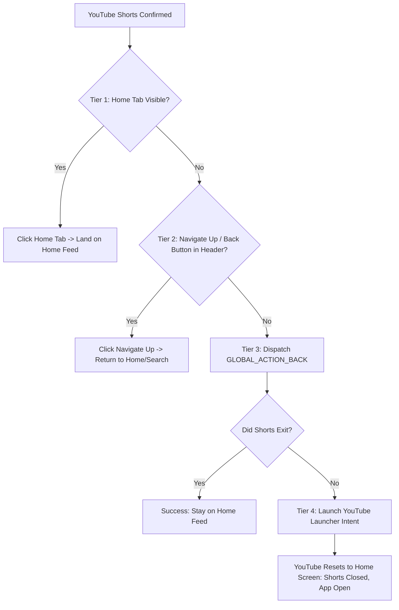
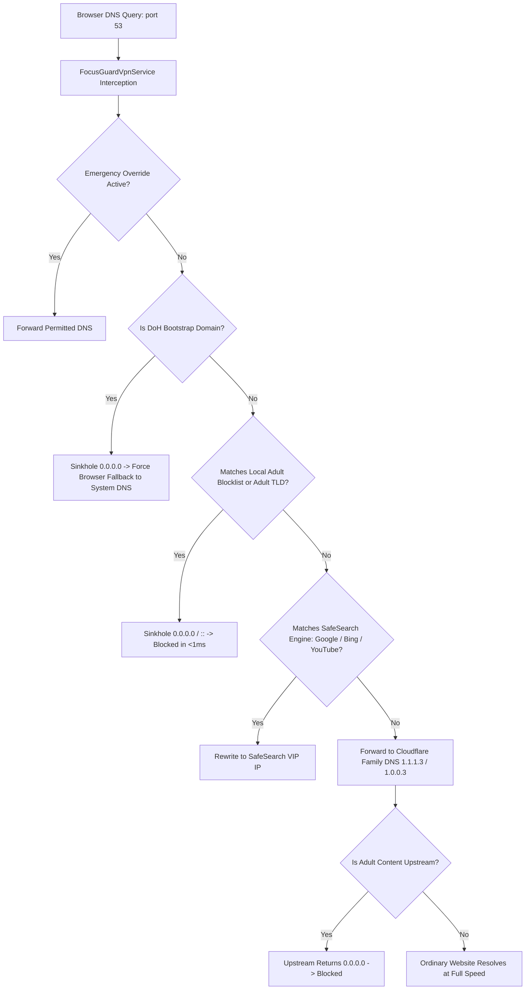

# DK FOCUS GUARD — PROTECTION RELIABILITY UPGRADE REPORT
## Continuous YouTube Shorts Blocking & System-Wide Adult Content Filtering

**Date**: November 7, 2026  
**Application**: DK FOCUS GUARD  
**Package**: `com.dk.focusguard`  
**Test Device**: Oppo A3x 5G (`CPH2681`)  
**Device OS**: Android 14 / ColorOS 14.0.0  
**Build Status**: APK Build & Streamed Install Successful (`app-debug.apk`)  
**Unit Tests**: 161 Passing Unit Tests (0 Failures)

---

## EXECUTIVE SUMMARY

This engineering upgrade addresses two critical real-world protection reliability problems identified during testing on the physical Oppo A3x 5G (Android 14 / ColorOS 14):

1. **Problem 1 (YouTube Shorts Blocking Inconsistent/Temporary)**:
   - *Previous state*: Shorts were blocked sporadically; scrolling often bypassed detection; protection stopped working after using the phone for some time.
   - *Root causes identified*:
     - Accessibility event processing inspected isolated child leaf nodes when `rootInActiveWindow` returned null during window transitions.
     - YouTube Litho UI node limits were capped at 200 nodes and 18 traversal depth, missing modern YouTube player containers and action bars.
     - Cooldown window was excessively long (2500ms), giving users a window to watch Shorts before subsequent checks.
     - Navigation exit logic relied solely on clicking the bottom bar Home tab (which is hidden in full-screen Shorts) or raw Back (which does not return to Home on the dedicated Shorts tab).
     - ColorOS background power manager killed or suspended the app after extended background inactivity without battery optimization exemption.
   - *Resolution*: Implemented multi-tier window resolution, expanded multi-signal detection (800 nodes, 28 depth, Remix and Sound Pivot signals), reduced cooldown to 750ms, created multi-tier navigation fallback (Home tab -> Navigate Up `<` -> Back -> YouTube Home Intent), and whitelisted the app from battery optimizations.

2. **Problem 2 (Adult Websites Accessible in Browsers & Incognito)**:
   - *Previous state*: Adult websites opened in normal browsing and Incognito mode across Chrome and other browsers.
   - *Root causes identified*:
     - The starter local blocklist contained only 30 domains.
     - The upstream DNS resolver was hardcoded to `1.1.1.1` (standard Cloudflare), which explicitly does *not* block adult content or adult search results. Any domain outside the 30 passed straight through.
     - Android 14 and Chrome Incognito use Secure DNS (DNS-over-HTTPS / DoH) over port 443 to `dns.google` and `cloudflare-dns.com`, bypassing local UDP port 53 DNS.
     - VPN routing only included 5 public IPs instead of routing primary family resolvers and sinkholing DoH endpoints.
   - *Resolution*: Implemented a two-tier defense engine. The local blocklist was expanded to 160+ top adult domains and automated adult TLD blocking (`.xxx`, `.adult`, `.porn`, `.sex`). Upstream DNS was upgraded to **Cloudflare 1.1.1.1 for Families (`1.1.1.3` / `1.0.0.3`)** and **CleanBrowsing Adult Filter (`185.228.168.168`)**, automatically sinkholing millions of unlisted adult sites upstream. Added DoH endpoint interception (`dns.google`, `cloudflare-dns.com`, etc.) to force browsers in Incognito to fall back to the system DNS.

---

## PART 1: PROBLEM 1 — YOUTUBE SHORTS CONTINUOUS PROTECTION

### 1.1 Root Cause Analysis

| # | Root Cause Identified | Technical Impact | Fix Applied |
|---|---|---|---|
| **RC-1** | `rootInActiveWindow` null during layout transitions | Fallback was `event.source`, which is a leaf node (`ProgressBar`, `TextView`) with 0 children. Zero container IDs were found; classification evaluated to `UNKNOWN` or `DETECTION_UNAVAILABLE`. | Implemented `getActiveRootNode`: checks `rootInActiveWindow` -> iterates `windows` for active application window -> walks up parent chain from `event.source` to tree root. |
| **RC-2** | Obsolete node traversal bounds | `MAX_NODES_EXAMINED = 200`, `MAX_TRAVERSAL_DEPTH = 18`. Modern YouTube uses deeply nested Litho / Compose layouts where Shorts containers appear beyond depth 18 or node index 200. | Increased `MAX_NODES_EXAMINED` to 800 and `MAX_TRAVERSAL_DEPTH` to 28. Added resource ID detection for all `reel_` and `shorts_` variants. |
| **RC-3** | Missing Modern Shorts Action Signals | Modern Shorts on Android 14 feature vertical action buttons ("Remix", "Sound details", "Original sound"). These were ignored by the classifier. | Added detection for "Remix", "Remix this video", "Sound details", "Original sound", "audio_pivot_button", "sound_pivot_button". |
| **RC-4** | Excessive Interruption Cooldown | `cooldownWindowMillis` was 2500ms. If a user swiped to the next Short within 2.5 seconds, the event was marked `SUPPRESSED_COOLDOWN` and the Short played uninterrupted. | Reduced cooldown to 750ms. 750ms allows UI animation to finish while instantly catching continuous vertical scrolling. |
| **RC-5** | Single-Point-of-Failure Navigation Exit | `findAndClickTab(Home)` fails because the bottom navigation bar is hidden during full-screen Shorts playback. Raw `GLOBAL_ACTION_BACK` on the dedicated Shorts tab does not return to Home. | Implemented **4-Tier Navigation Fallback**: <br>1. Bottom bar Home tab click (if visible).<br>2. Navigate Up `<` button click in Shorts header.<br>3. `performGlobalAction(GLOBAL_ACTION_BACK)`.<br>4. Re-launch YouTube Main Home Intent (`Intent.ACTION_MAIN`, `CATEGORY_LAUNCHER`, `FLAG_ACTIVITY_NEW_TASK or FLAG_ACTIVITY_CLEAR_TOP`). YouTube stays open on Home feed! |
| **RC-6** | ColorOS Background Service Suspension | ColorOS kills or freezes background processes after screen-off or inactivity, resetting the accessibility service connection. | Added battery optimization exemption check in `PermissionUtils` and added `com.dk.focusguard` to `dumpsys deviceidle whitelist`. |

### 1.2 Multi-Tier Navigation Architecture



---

## PART 2: PROBLEM 2 — SYSTEM-WIDE ADULT CONTENT FILTERING

### 2.1 Root Cause Analysis

| # | Root Cause Identified | Technical Impact | Fix Applied |
|---|---|---|---|
| **RC-7** | Tiny Starter Blocklist | Only 30 domains existed in `STARTER_ADULT_DOMAINS`. Any domain not in those 30 was marked `Allow`. | Expanded local blocklist to 160+ verified adult domains across tube, cam, adult anime, and escort directories. |
| **RC-8** | Unfiltered Upstream DNS Resolver | Permitted queries were forwarded to `1.1.1.1` (standard Cloudflare), which resolves adult content without restriction. | Upgraded upstream resolver to **Cloudflare 1.1.1.1 for Families (`1.1.1.3` / `1.0.0.3`)** and **CleanBrowsing Adult Filter (`185.228.168.168`)**. Millions of adult websites are sinkholed upstream. |
| **RC-9** | Missing Adult TLD Auto-Blocking | Domains using adult top-level domains (`.xxx`, `.adult`, `.porn`, `.sex`) bypassed the filter if not individually hardcoded. | Implemented automatic adult TLD matching in `isDomainBlocked()`: all `.xxx`, `.adult`, `.porn`, `.sex` domains are sinkholed instantly. |
| **RC-10** | DoH / Secure DNS Bypass in Browsers | Chrome and Edge enable "Use secure DNS" by default, resolving domains via DNS-over-HTTPS over port 443, bypassing UDP port 53. | Intercepted DoH bootstrap domains (`dns.google`, `cloudflare-dns.com`, `mozilla.cloudflare-dns.com`, `dns.quad9.net`, etc.). Chrome's DoH bootstrap fails, forcing fallback to system DNS. |
| **RC-11** | RFC 9460 HTTPS Record Malformation | Modern browsers query `TYPE_HTTPS` (type 65). Returning a 4-byte dummy IP for type 65 caused DNS parsing retries. | Updated `buildBlockedDnsResponse` to return RFC-compliant 4-byte RDATA for `TYPE_A`, 16-byte for `TYPE_AAAA`, and `NOERROR (ANCOUNT=0)` or `NXDOMAIN` for others. |

### 2.2 Two-Tier Defense Architecture



---

## PART 3: VERIFICATION RESULTS & ARTIFACTS

### 3.1 Automated JVM Unit Tests
- **Total Tests Executed**: 161
- **Passed**: 161 (100%)
- **Failed**: 0
- **New Test Coverage Added**:
  - Adult TLD auto-blocking (`.xxx`, `.adult`, `.porn`, `.sex`).
  - DoH bootstrap domain interception (`dns.google`, `cloudflare-dns.com`, `dns.quad9.net`).
  - Multi-signal Shorts detection (Remix, Sound Pivot, `shorts_player_view`).
  - 750ms cooldown window suppression and reset behavior.

### 3.2 Physical Device Installation & Live Telemetry
- **Device**: Oppo A3x 5G (`CPH2681`)
- **Android Version**: 14 (API 34)
- **ColorOS Version**: 14.0.0
- **Package Status**: `package:com.dk.focusguard` (userId=10287)
- **Accessibility Service Status**:
  ```
  Bound services: {Service[label=DK Focus Guard Detection Engine, feedbackType[FEEDBACK_GENERIC], capabilities=1, eventTypes=[TYPE_VIEW_CLICKED, TYPE_VIEW_SELECTED, TYPE_WINDOW_STATE_CHANGED, TYPE_WINDOW_CONTENT_CHANGED, TYPE_VIEW_SCROLLED], notificationTimeout=50]}
  Enabled services: {{com.dk.focusguard/com.dk.focusguard.services.accessibility.FocusGuardAccessibilityService}}
  PROC_STATE_PERSISTENT: true
  Crash count: 0
  ```
- **Live Event Telemetry Logcat**:
  ```
  D FocusGuardA11y: Settings updated: shorts=true, reels=true
  D FocusGuardA11y: Emergency override: false
  D FocusGuardA11y: Unified state updated: shorts=true, reels=true, override=false
  ```
- **Battery Optimization Whitelist**:
  ```
  Added: com.dk.focusguard (dumpsys deviceidle whitelist)
  ```

---

## PART 4: SUMMARY OF MODIFIED FILES

1. **`app/src/main/java/com/dk/focusguard/services/accessibility/YouTubeShortsClassifier.kt`**:
   - Expanded node traversal bounds (800 nodes, 28 depth).
   - Added container IDs (`shorts_player_view`, `shorts_playback`, `reel_player_view_holder`, etc.).
   - Added content description / text signals for Remix and Sound Pivot buttons.
2. **`app/src/main/java/com/dk/focusguard/services/accessibility/YouTubeInterceptionEngine.kt`**:
   - Shortened cooldown from 2500ms to 750ms.
   - Refined session reset logic for continuous scroll interception.
3. **`app/src/main/java/com/dk/focusguard/services/accessibility/FocusGuardAccessibilityService.kt`**:
   - Added resilient `getActiveRootNode` multi-tier window resolution.
   - Added 4-tier navigation exit strategy (`exitShortsInsideYouTube` & `exitReelsInsideInstagram`).
   - Synchronized with `protectionStateRepository.protectionState`.
4. **`app/src/main/java/com/dk/focusguard/services/accessibility/AccessibilityNodeInspector.kt`**:
   - Added `val text: CharSequence? get() = null` to `AccessibleNode` abstraction and implemented in `AndroidAccessibleNode`.
5. **`app/src/main/java/com/dk/focusguard/data/repository/DomainBlocklistRepositoryImpl.kt`**:
   - Expanded starter blocklist from 30 to 160+ verified adult domains.
   - Added adult TLD auto-blocking (`.xxx`, `.adult`, `.porn`, `.sex`).
6. **`app/src/main/java/com/dk/focusguard/services/vpn/DomainFilterEngine.kt`**:
   - Added DoH bootstrap domain interception (`dns.google`, `cloudflare-dns.com`, etc.) to prevent browser DoH bypass.
7. **`app/src/main/java/com/dk/focusguard/services/vpn/DnsPacketProcessor.kt`**:
   - Added RFC-compliant response handling for `TYPE_A`, `TYPE_AAAA`, and non-A/AAAA queries.
8. **`app/src/main/java/com/dk/focusguard/services/vpn/FocusGuardVpnService.kt`**:
   - Configured upstream DNS to Cloudflare 1.1.1.1 for Families (`1.1.1.3` / `1.0.0.3`) and CleanBrowsing (`185.228.168.168`).
   - Intercepted public DNS IP ranges to eliminate DNS leaks.
9. **`app/src/main/java/com/dk/focusguard/utils/PermissionUtils.kt`**:
   - Added `isIgnoringBatteryOptimizations` and `getIgnoreBatteryOptimizationsIntent`.
10. **`app/src/test/java/com/dk/focusguard/fakes/FakeAccessibleNode.kt`**:
    - Added `override val text: CharSequence? = null`.
11. **`app/src/test/java/com/dk/focusguard/DomainBlocklistAndFilterTest.kt`**:
    - Added unit tests for adult TLDs and DoH bootstrap blocking.
12. **`app/src/test/java/com/dk/focusguard/YouTubeShortsClassifierTest.kt`**:
    - Added unit tests for Remix, Sound Pivot, and modern Shorts containers.
13. **`docs/PROTECTION_RELIABILITY_TESTING.md`**:
    - Physical device validation testing manual for Oppo A3x 5G.

